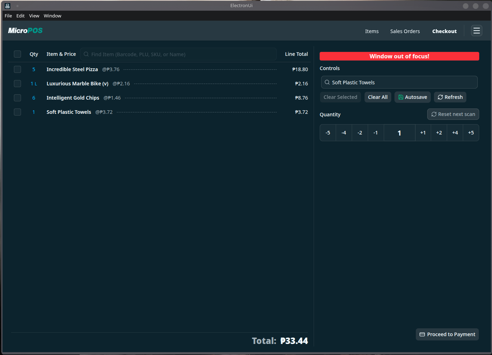
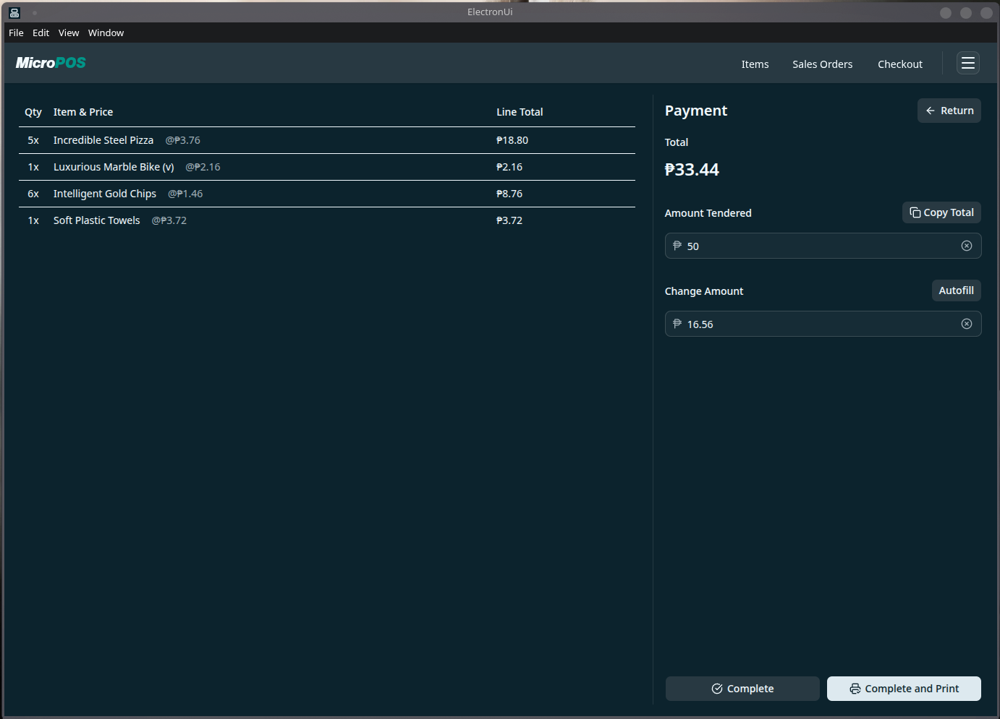
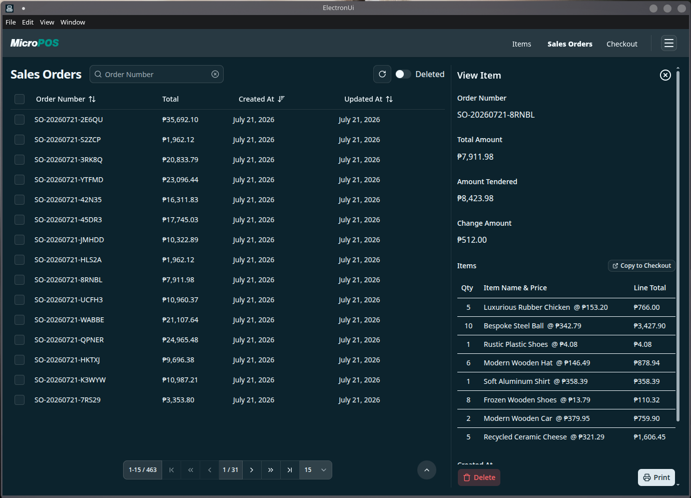
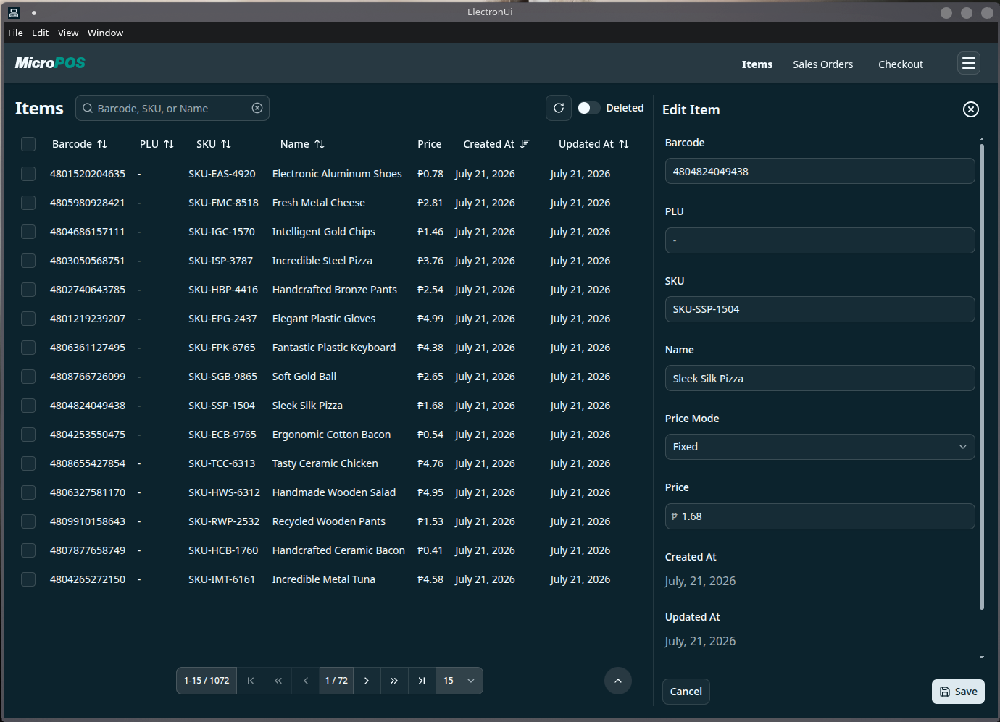

# MicroPOS

Offline-first desktop point of sale built with Electron and Angular. Runs on a local SQLite database and talks directly to USB receipt printers and HID barcode scanners.

## Preview

> This is an old repo used only for trying out Electron. It is not actively maintained.

| Checkout | Payment |
| -------- | ------- |
|  |  |

| Sales Orders | Items |
| ------------ | ----- |
|  |  |

## Features

- Checkout with barcode (EAN-13) and PLU lookup
- Payment and sales order history
- Item and sales order management with soft delete
- ESC/POS receipt printing over USB
- HID and USB barcode scanner support
- Store settings, branding assets, light/dark theme
- Prices stored as integer centavos (PHP)

## Tech Stack

| Layer    | Tools                                                      |
| -------- | ---------------------------------------------------------- |
| Desktop  | Electron 41, Electron Forge, Webpack                       |
| UI       | Angular 22 (signals, signal forms), Tailwind CSS 4, Spartan UI, TanStack Table |
| Data     | SQLite (better-sqlite3), Drizzle ORM and Drizzle Kit       |
| Hardware | node-hid, usb, @point-of-sale/receipt-printer-encoder      |
| Logging  | electron-log                                               |

## Project Structure

```
src/                 Electron main process
  bootstrap.ts       Startup pipeline (settings, DB, IPC, factories)
  config/            Database and logger setup
  db/                Drizzle schema, migrations, dev seed factories
  domain/            Repositories and IPC controls per domain
                     (items, sales orders, hardware, system)
  server/            Custom scheme handler, HTTPS/WebSocket client server (WIP)
  preload.ts         Context bridge for the renderer
angular/             Angular workspace
  projects/
    electron-ui/     Main POS UI loaded by Electron
    client/          Browser client for remote devices (WIP)
    shared/          Shared components, pipes, services, utils
  libs/ui/           Spartan UI (helm) components
shared/              Types shared between main process and UI
```

## Getting Started

Requirements: Node.js 22+, npm, and build tools for native modules (better-sqlite3, node-hid, usb, canvas).

```bash
npm install
npm install --prefix angular
npm run dev
```

`npm run dev` starts the Angular UI on `localhost:4200`, the client on `localhost:4300`, and Electron once the UI is ready.

> The root `postinstall` script unzips a cached Electron binary from a machine-specific path. Adjust or remove it if it fails on your system.

## Database

- Dev: `local-data/micropos.db`
- Packaged: `<userData>/micropos.db`

In development, sample data is seeded when the database is empty. To change the schema:

```bash
# edit src/db/schema, then
npx drizzle-kit generate
```

Migrations are output to `src/db/migrations` and applied on startup.

## Build

```bash
npm run build:ui --prefix angular
npm run build:client --prefix angular
npm run make
```

Packaging uses Electron Forge with the Squirrel (Windows) maker. Deb, RPM, and ZIP makers are available in `forge.config.ts`.

## License

MIT
